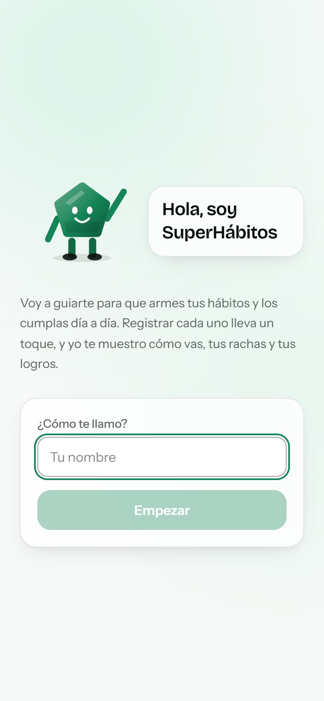
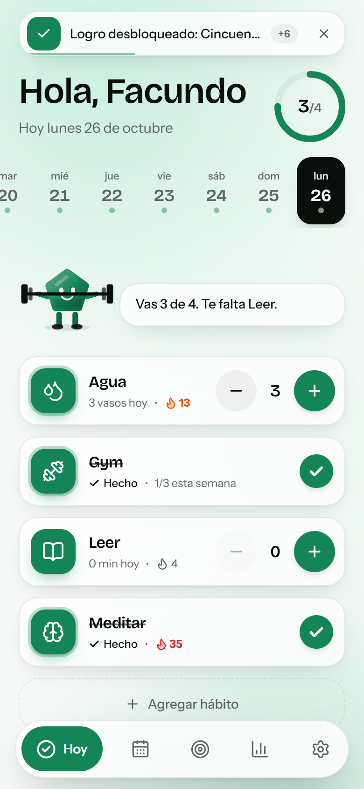
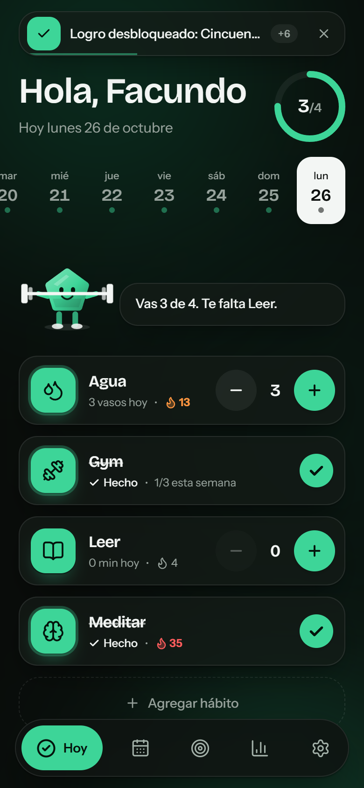
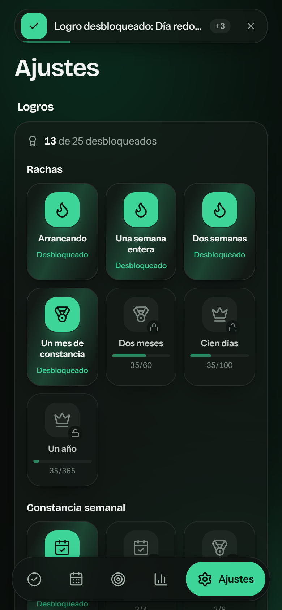

# SuperHábitos

Tracker de hábitos y objetivos para usar a diario desde el iPhone: **PWA** instalable, **Atajos de iOS** (widget y Siri) y **bot de Telegram** con lenguaje natural. Todo en capa gratuita (Vercel Hobby + Supabase Free + Telegram + Gemini/Groq).

<p>
  
  
  
  
</p>

## Estado
- Implementado y testeado: dominio, PWA, API de Atajos, bot de Telegram, sincronización, logros, auditoría (`docs/AUDIT.md`).
- **Pendiente: conectar credenciales** (Supabase, Telegram, LLM, Vercel) y probar de punta a punta. Seguí `docs/SETUP.md`.
- Próximos pasos priorizados por impacto: `docs/ROADMAP.md`.

## Qué hace
- **Bienvenida:** un personaje se presenta ("Hola, soy SuperHábitos"), pide tu nombre y pasa a la app.
- **Registrar en 1–2 toques:** tocá un hábito; en los de cantidad usá − / + o tocá para corregir el total del día. Avisos en cola en un espacio fijo, con "Deshacer".
- **Tira de fechas:** mirá y corregí cualquiera de los últimos 14 días.
- **Personaje vivo:** respira, parpadea y saluda; al tocar un hábito hace su actividad durante 10 s (pesas, tomar agua, leer, meditar, correr, dormir, bailar).
- **Objetivos** (cantidad, suma, frecuencia semanal, racha) con ritmo esperado vs real.
- **Rachas** con llama que pasa a naranja desde 10 y a rojo desde 30.
- **Logros** en Ajustes (rachas, constancia semanal, registros, días perfectos, objetivos) con insignias 3D y aviso al desbloquear.
- **Stats:** heatmap anual, rachas, cumplimiento a 30/90 días. Fechas siempre en tu zona horaria.
- **Modo claro y oscuro**, paleta blanco/negro/verde, sin emojis (íconos).
- **Sin señal:** funciona offline (IndexedDB) y sincroniza al volver.
- **API para Atajos** (`/api/quick/*`, ver `docs/IOS_SHORTCUTS.md`) y **bot de Telegram** que confirma antes de escribir (ver `docs/TELEGRAM.md`).

## Desarrollo local
```bash
npm install
cp .env.example .env.local   # sin variables la app funciona solo en el dispositivo
npm run dev
```
Scripts: `npm run lint` · `typecheck` · `test` · `e2e` · `build` · `db:generate` · `db:migrate`.

Los E2E usan el Chrome instalado (no descargan navegadores) y construyen en `.next-e2e`, así que no pisan un `next dev` en marcha.

## Estructura
```
app/              rutas UI y app/api/{quick,me,sync,telegram,cron}
components/       UI (popups, filas de hábito, personaje, logros, barra superior e inferior)
lib/domain/       lógica pura (fechas, rachas, objetivos, logros, matching) — testeada
lib/store/        IndexedDB (Dexie), hooks con caché y outbox de sincronización
lib/sync/         plan de push/pull (puro) + motor del cliente
lib/server/       Repo (memoria para tests, Drizzle en producción) y handlers de API
lib/nl/           NLParser: Gemini → Groq → reglas
lib/telegram/     bot, textos, recordatorios, webhook
lib/db/           esquema Drizzle, migraciones, RLS
tests/e2e/        Playwright (viewport iPhone)
docs/             arquitectura, free tier, guías, auditoría, hoja de ruta
```

## Seguridad
Resumen (detalle en `docs/AUDIT.md`): el servidor deriva el usuario de la sesión o del token, nunca del cliente; tokens hasheados y revocables; webhook y cron con secreto en tiempo constante; validación Zod con topes; RLS en todas las tablas; cabeceras de seguridad; ningún secreto en el cliente.
