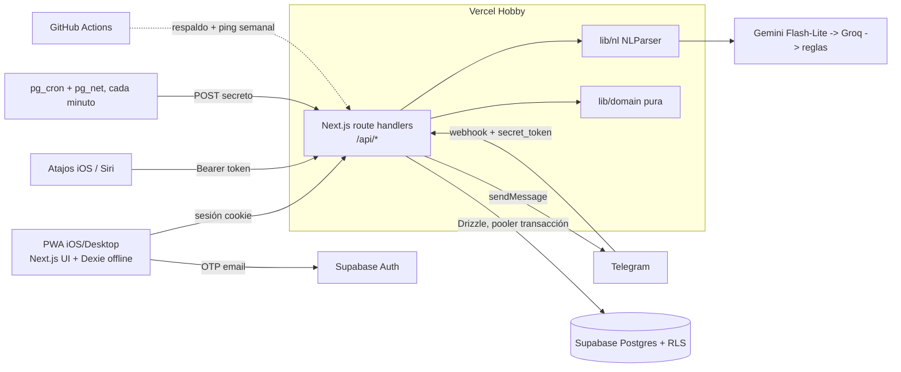

# Arquitectura



## Decisiones
1. **Next.js App Router + TS estricto + Tailwind 4**, un solo paquete (sin monorepo). UI, API de Atajos y webhook en un deploy.
2. **Auth: OTP de 6 dígitos por email** (Supabase). Magic link/OAuth en PWA standalone de iOS abren Safari con almacenamiento separado y la sesión no vuelve a la PWA. Google → backlog.
3. **Drizzle + pooler de Supabase** (modo transacción, `prepare: false`). Sin binario, ideal serverless. Conecta como `postgres` y bypassa RLS, por eso **un único camino de datos**: toda lectura/escritura pasa por route handlers que filtran por `user_id` de la sesión o del token. RLS activa en todas las tablas como defensa en profundidad.
4. **Cron**: `pg_cron` + `pg_net` (Vercel Hobby solo permite 1/día ±59 min).
5. **LLM**: `NLParser` con Gemini Flash-Lite (structured output) → Groq gpt-oss-20b → parser por reglas.
6. **Zod** compartido en `lib/schemas`; **TanStack Query** con optimistic updates; **Serwist + Dexie** para offline (`client_id` idempotente).
7. **Fechas**: `date-fns-tz` con la zona de `user_settings`; prohibido `toISOString().split('T')`.
8. **Atajos**: guía manual + botón que copia token y URL (los links iCloud no se generan programáticamente).

## Estructura
```
app/            rutas UI y app/api/{quick,telegram,cron}
lib/domain/     lógica pura (rachas, objetivos, semanas) + tests
lib/db/         schema Drizzle, migraciones, queries
lib/nl/         NLParser + implementaciones
lib/telegram/   handlers, teclados, mensajes
lib/schemas/    Zod compartido
docs/
```

## Riesgos
- Pausa de Supabase por inactividad (mitigado, ver FREE_TIER).
- Cuota/cambios del free tier del LLM (fallback a reglas).
- Cookies/almacenamiento de PWA iOS (OTP evita redirects).
- Precisión del cron (pg_cron por minuto).
- Hobby es no comercial.

## Credenciales que tenés que crear vos
1. **Supabase**: crear proyecto → Settings → API (URL, anon key, service role) y Database → Connection pooling (string modo Transaction). Auth → Providers → Email con OTP activado; en la plantilla de email usar `{{ .Token }}`. Habilitar extensiones `pg_cron` y `pg_net`.
2. **Telegram**: @BotFather → `/newbot` → token. Generar `TELEGRAM_WEBHOOK_SECRET` (string aleatorio).
3. **Gemini**: API key en https://aistudio.google.com (opcional Groq: https://console.groq.com).
4. **Vercel**: cuenta gratis, importar el repo de GitHub, cargar las env vars de `.env.example`.
5. **GitHub**: secretos de Actions (`APP_URL`, `CRON_SECRET`).
